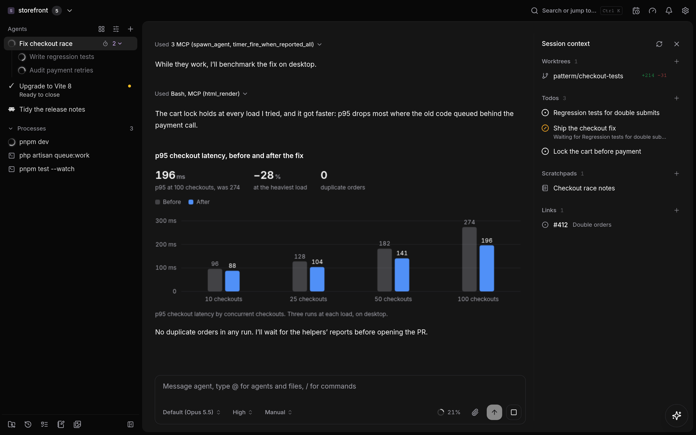

# Patterm

A workbench for the coding agents you already use.

Run Claude Code, Codex, OpenCode and Antigravity CLI (`agy`) as Integrated
conversations, signed in with your own accounts. Each project’s agents,
worktrees, diffs and history stay in one window. The native CLIs do the work.



*A demo project with synthetic data, shown in an earlier layout.*

**[Documentation](https://patterm.com/docs)** ·
**[Installation](https://patterm.com/docs/installation)** ·
**[Changelog](CHANGELOG.md)**

## What you can do

- **Work in conversations.** See native permission requests, plans and diffs,
  and inline charts, tables and diagrams. Run shells and commands in terminals.
- **Let agents start helpers.** Agents start helpers, message them and wait for
  their reports. Each one nests under the agent that started it.
- **Know when you're needed.** Permission prompts, questions and finished work
  land in one list, and notifications can follow you to your phone.
- **Review before anything lands.** Give a helper its own worktree, then read its
  changes file by file. Patterm never commits for you.
- **Keep plans outside the chat.** Todos with blockers and owners, and Markdown
  scratchpads that agents read and write too.
- **Find old conversations.** Search Claude Code, Codex, OpenCode and
  Antigravity history, including sessions started outside Patterm.
- **Watch your limits.** See available Claude Code, Codex and Antigravity
  limits and reset times.
- **Work while you're away.** Routines start an agent on a schedule, and notify
  you when it reports.
- **Pair your machines.** Agents on your dev box and your desktop can message
  each other, and you see all of them in one window. Manage remote settings,
  notifications, routines and usage from the host switcher.
- **Organise your workspace.** Group agent and process tabs in folders, search
  settings, and use the Get started checklist on a new install.
- **Share secrets with care.** Agents can request credentials without putting
  their values in the conversation; see [agent secrets](docs/agent-secrets.md).

## Install

On Linux x64 or arm64 with systemd:

```sh
curl -fsSL https://github.com/hjbdev/patterm/releases/latest/download/install.sh | bash
patterm
```

Install and sign in to the agent CLIs you want to use separately. Add a project
folder, then use **+** to open a new conversation. Choose a CLI, project and
model, attach files if needed, and send the first message. Releases bundle
Node, Electron and the terminal engine; check for updates in Settings › About.

For Antigravity, install the [official CLI](https://antigravity.google/docs/install/)
and run `agy acp --login` on the machine hosting Patterm, then choose
**Antigravity** in a new conversation. Model choices come from `agy models`;
you can configure profiles and MCP servers in Settings. Native history imports
automatically. Hidden memory updates and automatic idle compaction are not
supported for agy yet; native questions appear in the conversation rather than
Patterm forms. Antigravity uses `help` and `call` to reach Patterm tools beyond
its core catalogue, avoiding the CLI’s MCP declaration size limit.

New Antigravity sessions use **Auto** when the account and platform offer it.
In Auto, Patterm approves MCP reads **and writes** on servers supplied to the
session. Change **MCP in Auto** to **Ask for MCP tools** to review those requests;
Default and Plan modes leave MCP approval to agy's native rules. Shell, file and web
requests still follow agy's native policy, and native deny rules still block.
This is scoped client approval, not `--dangerously-skip-permissions`, and never
changes agy's global configuration. Model, thinking level, mode and MCP choice
are saved per conversation and restored when it resumes. Explicit model or
thinking overrides at resume take precedence. Accounts without Auto retain their
native mode and show a notice instead of pretending Auto is active.
Images are sent inline. PDFs are passed as validated file references for agy's
native tools to read; native file-access prompts can still apply. Embedded PDF
blobs are not used because agy 1.5.8 silently ignores them.
Follow-up messages steer a running turn; they wait while a permission request
is open.

The Usage page reads Antigravity's model-group quotas and reset times through
`agy --print /usage --output-format json`, at most once a minute while the page
is open. This native command makes no model request and needs no active agent
or history import. Failed refreshes keep the last figures and their Seen time.

To keep agents running on a machine that stays on, run Patterm as a background
service and open it in any browser:

```sh
patterm --headless                    # http://localhost:8787 on that machine
patterm --headless --tailscale-serve  # private HTTPS on your tailnet
```

Closing the browser stops nothing; agents, processes, timers and imports keep
running. See [Linux server](https://patterm.com/docs/linux-server) and
[Browser and phone access](https://patterm.com/docs/browser-and-phone).

Experimental desktop builds for macOS (Apple Silicon and Intel) and Windows 10
or 11 are attached to each [release](https://github.com/hjbdev/patterm/releases).
They haven't had hands-on testing with agent CLIs yet, and have no background
service.

Agents can render HTML figures in replies with `html_render`; saved templates
let them fill a versioned page with data. Manage figures and inspect template
versions in Settings › Figures. Local agents can use `stay_quiet` to finish a
turn without a turn-finished notification.

## What Patterm is not

- It is not an agent. It does not call a model API directly; the CLIs use
  their own credentials.
- Each CLI keeps its own login and runs with your account's permissions.
  Patterm renders native approval requests; Antigravity's scoped MCP approval
  policy is described above.
- It doesn't commit or open pull requests. Agents use their own git and `gh`
  workflows, and Patterm only records the links they attach.
- It keeps your data in SQLite on the hosting machine and doesn't record raw
  terminal output by default. Opt-in [automatic summaries](docs/automatic-summaries.md)
  send redacted text through a CLI you choose.

## Development

Use Node >=24.11 <27, pnpm v11, Rust/Cargo and Git.

```sh
pnpm install
pnpm run dev           # desktop app
pnpm run typecheck
pnpm run check
pnpm run build:server  # server, renderer, MCP shim and release sidecar
```

[Development](docs/development.md) covers source installs, macOS and Windows
packaging, the OpenCode bridge and Linux launch troubleshooting.
[Running from source](docs/running-from-source.md) covers a background service
built from a checkout, its settings, updates, backups and rollback.

```text
Vue UI → command → action → services/models → events/listeners
Browser HTTP/WebSocket or Electron IPC → shared validation and dispatch
Node service → SQLite, local MCP socket, history worker, Rust PTY sidecar
```

The Rust sidecar owns terminal parsing, state, scrollback, selection and process
lifecycle, on `alacritty_terminal`. The custom WebGPU renderer has a WebGL
fallback, and terminal frames bypass Vue reactive state. See the
[backend conventions](app/README.md) and [AGENTS.md](AGENTS.md).

## Licence

Patterm is released under the MIT licence; see `LICENSE`. `THIRD_PARTY_NOTICES.md`
lists the shipped npm packages, Electron, the sidecar's Rust crates and statically
linked libraries, and copied source with their licences. Run `pnpm run notices`
after changing dependencies. `pnpm run check` fails when the file is out of date,
or when a dependency has no licence, no licence file, or a copyleft licence that
needs review. Add missing licence texts to `scripts/third-party-licences/`.

Claude Code, Codex, and OpenCode are trademarks of their respective owners.
Patterm uses these names, and the Claude Code, Codex, and OpenCode logos, only to
identify the CLIs it hosts. Patterm is not affiliated with or endorsed by them.
