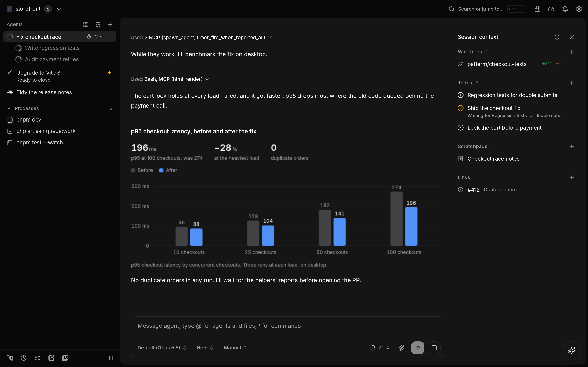

# Patterm

Patterm hosts existing agent CLIs through PTYs. Projects directly contain agents,
processes, worktrees, diffs, imported conversation history, todos, and scratchpads. Use the Vue UI in
Electron or through a browser connected to a Linux background service.
Native CLI permissions, delegation, messaging, reports, timers, and resume IDs
remain part of each agent's workflow.

Run Claude Code, Codex, and OpenCode alongside each other, with their native
terminal interfaces or Patterm's Integrated conversation view. Keep each project's
worktrees, local diffs, notes, and agent handoffs together. A background service
keeps agents running when you close the browser; Tailscale can provide private
access from your other devices.



*A demo project with synthetic data.*

## Quick start

On Linux x64 or arm64 with systemd:

```sh
curl -fsSL https://github.com/hjbdev/patterm/releases/latest/download/install.sh | bash
patterm
```

Install and sign into the agent CLIs you want to use separately. Add a project
folder in Patterm, then choose a CLI from **Launch agent**. The release bundles
Node, Electron, and the terminal engine; Node, pnpm, and Rust are only needed
to build from source.

For the background browser service, run `patterm --headless`, then open
`http://localhost:8787` on that machine. See [Installation and updates](#installation-and-updates)
below and [Linux background service](#linux-background-service) for private access
from another device.

## v0.1 support and limitations

- Release packages support Linux x64 and arm64 with systemd. The desktop app
  needs a graphical session and Electron's system libraries.
- Experimental macOS desktop packages are available for Apple Silicon and Intel
  (see [macOS](#macos)). They are not Apple notarized; there is no Mac background
  service installer.
- Experimental Windows desktop packages support Windows 10 or 11, with a
  portable zip and per-user PowerShell installer (see [Windows](#windows)).
  There is no background service or Tailscale setup yet.
- Patterm runs CLIs with your user account's permissions. Each CLI keeps its own
  authentication and approval workflow.
- Browser disconnection leaves agents running. A machine reboot requires explicit
  native resume; Patterm does not automatically resume agents after reboot.
- Local files and conversation history stay on the hosting machine. Optional
  automatic summaries send selected text through your configured CLI; read
  [the summary documentation](docs/automatic-summaries.md) before enabling them.

## Project context

Open **Todos** or **Scratchpads** from the project toolbar. Todos support priority,
status, assignees, and blockers. Assignments describe responsibility; expiring
leases identify active work. The user can revoke a lease. Completing a todo releases
its lease without stopping the agent or closing an external issue.

Scratchpads autosave Markdown. Failed saves and revision conflicts preserve a
tab-scoped draft that survives reloads without affecting another tab's edits. Keep
the tab open or copy the draft before closing it. Copy the draft before reloading
the latest document to reconcile changes. Archive notes through their status
control. Use **Save selection to scratchpad** to capture selected terminal text
explicitly.

Open **Context** beside an agent terminal to see its assigned todos, attached
scratchpads, and external links. Resize the divider with the pointer or arrow keys;
collapse the panel to reclaim space. On narrow panes it opens over the terminal.
Panel preferences belong to the client. Explicit native resume carries links,
notes, and incomplete assignments forward; the resumed agent acquires fresh leases.

Agents can call the `todo`, `scratchpad`, `reference`, and `session` MCP tools directly.
`session_context` infers the calling session and returns its `session_id`
alongside paginated context. Owner/UI calls provide `project_id` and `session_id`.
For an external identifier such as `PAT-1`, resolve it through the provider MCP or
CLI first, then attach the verified URL:

```json
{
  "target_type": "session",
  "target_id": "SESSION_ID",
  "url": "https://linear.app/example/issue/PAT-1",
  "provider": "linear",
  "resource_type": "issue",
  "identifier": "PAT-1"
}
```

Replace `SESSION_ID` with the ID from `session_context`, and use the URL
returned by the provider. Pass these arguments directly to `reference_attach`. Patterm
stores the reference; it does not fetch or synchronise provider data.

Tool help documents revision guards and pagination. Todo leases default to 300
seconds (1–86,400 allowed); retain the returned token for explicit renewal/release.
List reads omit note bodies. Scratchpad reads return up to 200 lines by default
(1,000 maximum per request); paginate and verify matching revisions before editing
a complete document. Titles allow 500 characters and bodies allow 262,144.

## Installation and updates

Release installs check for a newer release every few hours, and Settings › About
installs it with the steps below: the desktop app quits, installs, and opens
again, and a server restarts its service. Each check reads the signed release
manifest from GitHub and verifies it with the key the installed version
shipped with. Turn automatic checks off, or include pre-releases, in Settings ›
About. Source checkouts never check.

Patterm releases run on Linux (x64 and arm64) with systemd. They bundle their
own Node and Electron, so you don't need Node, pnpm, or Rust. Install the latest
stable release:

```sh
curl -fsSL https://github.com/hjbdev/patterm/releases/latest/download/install.sh | bash
```

The installer downloads the release for your architecture and checks it against
the release's SHA-256. It also checks the release manifest's signature, with
`minisign` on a first install if you have it, and on updates with the key the
installed version shipped with. Each version unpacks into
`~/.local/share/patterm/versions/<version>`; set `PATTERM_HOME` to install
somewhere other than `~/.local/share/patterm`. The `current` symlink beside
them names the version in use, and the version before it is kept for a
rollback. The installer links `~/.local/bin/patterm` and adds a desktop entry.

To update a running background service, rerun the installer with `--update`:

```sh
curl -fsSL https://github.com/hjbdev/patterm/releases/latest/download/install.sh | bash -s -- --update
```

Quit the desktop app before updating. Versions still used by running agents
are retained until a later update can safely remove them. Concurrent installers
are rejected.
It stops the service, switches versions, restarts it, and waits for `/health`.
If the service came from an earlier from-source install in
`~/.local/share/patterm-desktop`, the installer moves it to the release and
deletes that directory once the new service is healthy. It keeps the directory
while any process still runs from it, such as an agent started before the
update, and a later `--update` removes it.
Add `--version 1.3.0-beta.1` to install a particular release, including
pre-releases. The installer refuses to go back to an older version without
`--allow-downgrade`, because an older Patterm may not open databases a newer one
migrated.

To remove Patterm, run the release's `uninstall.sh`. It stops every Patterm agent
and terminal, removes the services, launcher, and installed versions, and asks
before deleting your data. If it can't confirm that Patterm stopped, it removes
nothing:

```sh
curl -fsSL https://github.com/hjbdev/patterm/releases/latest/download/uninstall.sh | bash
```

Release tags build Linux tarballs, Windows x64 packages, and macOS Apple Silicon
and Intel app zips in GitHub Actions. A plain tag such as `v1.2.0` is a stable
release; a suffix such as `v1.3.0-beta.1` marks a pre-release. **macOS and Windows
builds remain experimental in both stable releases and pre-releases.** Every
release includes this caveat above its generated change notes.

## Development

Use Node >=24 <27, pnpm v11, Rust/Cargo, Git, and the agent CLIs you want to run.
The server uses Node's built-in `node:sqlite`; it does not need Electron or a
graphical session at runtime.

```sh
pnpm install
pnpm run typecheck
pnpm run check
pnpm run build:server
node --test tests/serviceInstallerSmoke.mjs
```

`build:server` compiles the Node application, renderer, MCP shim, and release
Rust sidecar. `start:server` runs the built server. For desktop development,
use `pnpm run dev`; `pnpm run build` builds desktop artefacts.
Install the desktop app and background server from source with `./install.sh`. Launch the GUI
with `patterm`, or start the systemd user service without a window:

```sh
patterm --headless
```

`install.sh` and `update.sh` install the release build of the terminal sidecar.
Pass `--debug` to give the desktop app the debug build instead; the service
always runs the release build.

For automatic Tailscale hostname detection and HTTPS proxy setup, run this on the
machine hosting Patterm:

```sh
patterm --headless --tailscale-serve
```

Tailscale must already be installed and connected. Restrict the machine's TCP
port 443 to your identity in tailnet policy before running this command. If
Tailscale requires administrator permission, grant your account operator access
once with `sudo tailscale set --operator="$USER"`. Run Patterm without sudo.
Tailscale may print a link to enable HTTPS during setup.

The command detects the machine's full Tailscale DNS name, prepares the user
service, starts it, and configures `tailscale serve --bg --https=443` to proxy to
the service's local port. It prints the HTTPS URL when setup succeeds. Existing
service settings are retained, with only the browser origin updated if needed.
If that update requires stopping a running service, it exits with instructions
instead of interrupting agents. Conflicting routes and Funnel exposure on the
endpoint are rejected. Repeating the command reuses a matching Serve route.
It does not enable service startup at login or lingering.

The first headless launch prepares `patterm.service` with a localhost origin
(`http://localhost:8787` by default). Set `PATTERM_PUBLIC_ORIGIN` for a configured
Tailscale origin. Existing service configuration is preserved. Subsequent launches
start the same service; they do not restart it or interrupt its agents.
Use `systemctl --user stop patterm.service` to stop it. Starting the service does
not enable startup at login or persistence after logout; see the service setup below.
Desktop and server keep separate data directories.

The installer replaces the `patterm-desktop` launcher with `patterm`. It retains
the existing desktop application and data paths so projects and history remain
available. Remove any unrelated `/usr/local/bin/patterm` installation before using
the new command. Stop the background service before reinstalling.

### macOS

Install or update the latest release without administrator access:

```sh
curl -fsSL https://github.com/hjbdev/patterm/releases/latest/download/install-macos.sh | bash
```

Quit Patterm and rerun the same command to update. The installer checks the
archive checksum and app signature, installs in `~/Applications`, and keeps
`Patterm.previous.app`. If Patterm is already in `/Applications`, it updates
that copy instead; that directory must be writable. Set
`PATTERM_MAC_APPLICATIONS_DIR` to choose another directory. It refuses updates
while the installed app runs, accidental downgrades, and concurrent installs.
A failed app switch restores the old app; app data stays separate. Use
`--version` to select a release, and `--allow-downgrade` only with a matching
pre-migration database backup. Gatekeeper approval may still be required.

You can also download `patterm-<version>-macos-arm64.zip` for Apple Silicon or
`patterm-<version>-macos-x64.zip` for Intel from the
[release assets](https://github.com/hjbdev/patterm/releases). Each zip has a
matching `.sha256` file. Unzip it, move `Patterm.app` to Applications, and open it.
Install and sign into your agent CLIs separately.

These experimental builds are ad-hoc signed, not signed with an Apple Developer
ID or notarized. macOS may block opening a downloaded app; after attempting to
open it, use **System Settings → Privacy & Security → Open Anyway** if you trust
the build. Hands-on testing with agent CLIs is still needed before treating
these builds as supported. The Linux service installer does not apply to macOS.

CI uploads both architectures as `macos-arm64` and `macos-x64` artifacts on pull
requests and pushes to main. Tagged releases attach the same app zip format.
To package locally on a Mac of the target architecture:

```sh
pnpm install --frozen-lockfile
pnpm run build:main
pnpm run build:renderer
pnpm run build:mcp
pnpm run build:sidecar:release
node scripts/release/package-macos.mjs --version 0.1.0 --sidecar native/terminal-core/target/release/patterm-terminal-core --out out/release
MAC_PACKAGE_DIRECTORY=out/release node --test tests/macPackageSmoke.mjs
```

### Windows

Windows desktop builds are experimental, including those attached to stable
releases. Automated checks pass, but hands-on testing with agent CLIs is still
needed before treating these builds as supported.

Install the latest Windows x64 release from PowerShell (no administrator access needed):

```powershell
irm https://github.com/hjbdev/patterm/releases/latest/download/install.ps1 | iex
patterm
```

The installer checks the zip’s SHA-256 and installs under `%LOCALAPPDATA%\Patterm`,
with a Patterm entry in your Start menu and a `patterm` command on your user PATH.
Run the installer again to select the latest release; the Start menu shortcut
follows the selected version. The installer refuses updates while the installed
app runs; quit Patterm and rerun the same command. It blocks concurrent installs
and accidental downgrades, and switches the launcher only after setup succeeds.
If an update fails, the previous launcher remains usable; rerun to retry.
App data and native CLI transcripts stay separate from the installed versions.
For a specific release, download `install.ps1` and run it with `-Version 0.1.1`.
Use `-AllowDowngrade` only with a matching pre-migration database backup.

The desktop app runs natively on Windows 10 (1809 or later) and 11. To run from
source instead, install Node 24 or later, pnpm 11, Rust with the MSVC toolchain,
and Git for Windows, then run from PowerShell:

```powershell
pnpm install
pnpm run dev
```

Agents run in Windows pseudoconsoles. Raw terminals and commands use PowerShell
7 when it is installed, otherwise Windows PowerShell. Agent CLIs installed by
npm or pnpm as `.cmd` shims are started through their Node scripts. Data lives
in `%LOCALAPPDATA%\patterm-desktop` (`patterm-desktop-dev` for development
builds).

Terminals run in detached hosts, so they keep running when the app restarts.
**Quit Patterm** stops every host. If the app crashes, its hosts keep their
agents until the next start reconnects to them or a quit stops them.
Integrated Codex agents talk to `codex app-server` over stdio on Windows.

Some tests create symbolic links and skip those checks unless Windows allows
it (Developer Mode or an elevated shell).

Releases attach `patterm-<version>-windows-x64.zip`, and each CI run
uploads the same build as an artifact. Unzip it anywhere and run `Patterm.cmd`.
Build one locally after `pnpm run build:main`, `build:renderer`, `build:mcp`,
and `build:sidecar:release`:

```powershell
node scripts/release/package-windows.mjs --version 0.1.0-local.1 --sidecar native/terminal-core/target/release/patterm-terminal-core.exe --out release
```

### OpenCode

Install `opencode` on the service account's `PATH`. Patterm launches the native
TUI against OpenCode's shared background server, without `--standalone`. The
stored provider ID remains `opencode` so existing history stays linked.

Before attaching the TUI, Patterm creates or resolves the native session, adds
its startup instructions through the session API, and registers a runtime-only
MCP bridge for that directory. MCP session metadata selects the corresponding
active Patterm identity. Calls from unregistered native sessions are rejected.
No global OpenCode configuration files or permission settings are changed.

Patterm keeps a persistent copy of `cli.json` for its terminal preferences. On
launch, it merges changes from your main OpenCode config. Preferences changed
inside Patterm win conflicts, including deleted settings; arrays are treated as
one setting. The default OpenCode palette uses Patterm's dark background, while
input, accent, text, and syntax colours retain their native values.

Stop, Close, and graceful Patterm shutdown interrupt the attached OpenCode
sessions, but do not stop the shared server or unrelated OpenCode sessions.
A Patterm crash can leave native work running; inspect OpenCode before resuming.
If OpenCode's server restarts, launching or resuming a Patterm agent registers
the bridge again. The runtime MCP registration is not a persistent config edit.

Existing imported history remains readable. Resuming requires the
session to exist in the OpenCode server; Patterm does not migrate native OpenCode data.
Run `pnpm run test:opencode` for the bridge regressions, or set
`PATTERM_TEST_OPENCODE` to the absolute binary path for temporary-only shared-server
acceptance tests without model calls.


## Linux background service

Run the service under the development account that owns the repositories and
agent CLI credentials. Build in a stable checkout that remains available after
logout. The installer records the absolute checkout and Node executable paths.
Re-run it after moving either path or replacing a version-managed Node install.

1. Inspect existing Tailscale configuration and obtain this machine's tailnet
   DNS name. Set `PATTERM_PUBLIC_ORIGIN` to the exact HTTPS origin, without a
   trailing slash, for example `https://patterm.example.ts.net`.

   ```sh
   tailscale status
   tailscale serve status
   ```

2. Restrict the destination's HTTPS access to the intended owner in tailnet
   policy. Remove broader rules that already allow the same destination;
   adding a narrow grant does not cancel existing broad access. Browser access
   grants command execution as the service account. Patterm has no separate
   browser login. Do not enable Tailscale Funnel. See the
   [Tailscale grant examples](https://tailscale.com/docs/reference/examples/grants).

3. Build and prepare the user unit. Replace the example origin with your own.

   ```sh
   pnpm run build:server
   PATTERM_PUBLIC_ORIGIN=https://patterm.example.ts.net pnpm run install:service
   ```

   The installer writes `~/.config/systemd/user/patterm.service`, the independent
   `patterm-terminal@.service` template, and
   `~/.config/patterm/patterm.env`, respecting `XDG_CONFIG_HOME` when set.
   It does not start services, enable lingering, or change Tailscale routes.
   Review these files, especially `PATH`, `SHELL`, the data directory, and origin.
   The service does not rely on an interactive terminal's temporary environment.
   Keep the required harness executables and credentials available to this account.

4. Enable the service and boot startup. Use your development account name for
   `USER_NAME`; enabling lingering might require administrator permission.

   ```sh
   systemctl --user daemon-reload
   systemctl --user enable --now patterm.service
   loginctl enable-linger USER_NAME
   systemctl --user status patterm.service
   curl --fail http://127.0.0.1:8787/health
   ```

5. After checking existing Serve routes, configure the loopback proxy and confirm
   that its reported URL matches `PATTERM_PUBLIC_ORIGIN`.

   ```sh
   tailscale serve --bg --https=443 http://127.0.0.1:8787
   tailscale serve status
   ```

   Serve provides private tailnet HTTPS access and persists the proxy with `--bg`.
   See the [Tailscale Serve command reference](https://tailscale.com/docs/reference/tailscale-cli/serve).
   If port 443 already serves another application, resolve that routing conflict
   before replacing its configuration.

6. Open the HTTPS URL, register a server project path, and launch an agent.
   Close the browser and reconnect to confirm that its process continues.
   Reboot the server, open the URL without SSH login, and explicitly resume a
   previous native conversation. Test that another tailnet user without access
   cannot open the application.

For a local-only preview, set `PATTERM_PUBLIC_ORIGIN=http://localhost:8787` and
use that browser URL. The installer also accepts `PUBLIC_ORIGIN` or
`--public-origin`. `--output-dir` writes preview files to a chosen directory,
without requiring built artefacts or touching live configuration:

```sh
node scripts/install-service.mjs --public-origin http://localhost:8787 --output-dir /tmp/patterm-unit-preview
systemd-analyze --user verify /tmp/patterm-unit-preview/patterm.service
```

The unit uses `Restart=on-failure`, `KillMode=control-group`, and
`TimeoutStopSec=25`. The installer quotes command arguments, escapes systemd
specifier characters in unit paths, and preserves literal environment values.
The environment file uses systemd syntax; do not source it as a shell script.

## Configuration and operation

### Install as a web app

Open the Tailscale HTTPS URL in a browser that supports PWA installation, then
use its **Install app** command. On iPhone/iPad, use Safari's **Add to Home
Screen** action. Keep Tailscale connected on that device. Each server origin is
a separate installed app and connects to its own server.

The manifest supplies standalone display, app icons, and a dark launch colour.
An offline landing page explains how to reconnect. The service worker caches
only that page and its icons. API data, conversation history, uploads, and
commands are never cached or queued by it. Live work requires server access.
Updates wait for existing app windows to close; they do not reload a live terminal.

PWA registration is enabled in production browser builds only. Electron keeps
its native runtime. Local testing can use `http://localhost:8787`; remote
installation requires the HTTPS URL supplied by Tailscale Serve.

### Server settings

The browser uses shareable URLs for projects, agent and process terminals,
worktrees, agent diffs, and conversation history. Refresh and Back/Forward
preserve the selected page. History links can include `conversation` and
`message` query parameters. Opening a terminal link does not resume a stopped
agent or launch a process. Electron uses the same routes after `#` in its local URL.

| Setting | Default or requirement |
| --- | --- |
| `PATTERM_PUBLIC_ORIGIN` | Installer requires an HTTPS `*.ts.net` origin or localhost origin, without a path. |
| `PATTERM_PORT` | `8787`; the listener binds to `127.0.0.1`. |
| `PATTERM_DATA_DIR` | `~/.local/share/patterm-server`; also settable with installer `--data-dir`. |
| `PATTERM_SIDECAR` | Absolute release sidecar path under the checkout. |
| `PATTERM_MCP_SHIM` | Absolute `dist/mcp/patterm-mcp.js` path under the checkout. |
| `PATTERM_OWNER_LOGIN` | Optional. Refuses tailnet requests that Tailscale says come from another login; set with installer `--owner-login`. Tagged devices send no login, so the tailnet policy or a password decides those. |
| `PATH`, `HOME`, `SHELL` | Recorded from the installing account, with Node's directory on `PATH`. |

The browser UI and API share one origin. HTTP and WebSocket requests validate
Host and Origin; browser calls run as the owner and cannot choose another
process identity. The CLI MCP socket remains local and answers only agents
Patterm started: each call must carry a running agent's identity, and MCP server
helpers get only the servers assigned to that agent's harness. Host/Origin
checks are not a substitute for restricting tailnet access.

Only your account and root (`tailscaled`, which runs Tailscale Serve) can
connect to the listener; connections from other accounts on the machine are
closed. Requests through Tailscale Funnel are always refused.

**Settings → Remote access** sets an optional password. With one, `/api` and
the live connection need a sign-in cookie (`HttpOnly`, `SameSite=Strict`, valid
for a year); pages and `/health` stay open so the sign-in page loads. Changing
or removing the password signs out every browser. Only a scrypt hash is kept, in
`server-access.json` in the data directory. If you forget the password, stop
the service, delete that file, and start it again.

**Settings → Remote access** also chooses where browsers can open Patterm from.
Applying a change restarts the web server under systemd; agents and terminals
keep running, and open pages reconnect.

- **This machine** (the default for new installs): only `127.0.0.1`.
- **Tailscale**: Patterm adds its own route, `/` on HTTPS port 443, to Tailscale
  Serve when it starts, and removes it when you switch away. It leaves other
  apps' paths alone and refuses to replace another root route or to run while
  Funnel is on. **Only me** refuses requests that Tailscale says come from
  another login.
- **Network**: Patterm also listens on one of this machine's addresses. This
  needs a password, and the connection is plain HTTP, so use it only on
  networks you trust.

The installer takes the same choice, so the server is reachable without opening
Settings first. A password for network access is read from standard input or
asked for on the terminal:

```sh
pnpm run install:service --remote-access tailscale
printf '%s\n' 'your password' | pnpm run install:service --remote-access network --bind 192.0.2.20 --password-stdin
```

The installer refuses to change the setting while `patterm.service` runs, because
the running server would overwrite it. Servers installed before this setting
keep using `PATTERM_PUBLIC_ORIGIN` and their own Serve configuration until you
choose a mode.

```sh
systemctl --user status patterm.service
journalctl --user -u patterm.service -f
systemctl --user stop patterm.service
systemctl --user start patterm.service
systemctl --user disable --now patterm.service
```

Server startup/shutdown output goes to the journal. Raw PTY recording is disabled
by default. `/health` returns readiness including terminal-sidecar availability.
A sidecar failure shuts down the service for recovery. A second application using
the same data directory fails to acquire its runtime lock.

Browser closure, sleep, or network loss does not stop agents, processes, timers,
or imports. Reconnection reloads state and terminal snapshots. Only one browser
controls each terminal; other browsers can view and explicitly take control.
Installed Linux services keep terminals in independent `patterm-terminal@…`
units. Stopping or restarting `patterm.service` preserves their processes,
including native sleeps. Startup reconnects to the same terminals and restores
control. Patterm timers retain their deadlines; overdue callbacks run after
reconnection. MCP calls can fail while the backend is unavailable and are not
automatically replayed.

Use **Quit Patterm** in the command palette to stop everything. Its confirmation
describes the agents and commands across all projects that will stop, including
sleeps and Patterm timers. Quit stops all registered host generations with bounded
systemd cleanup. Closing a browser tab only disconnects it. Reboot or terminal-host
failure ends affected processes; saved conversations require explicit native resume.

For an installed service, `./update.sh` builds and stages the checkout before
restarting the application. Refresh the browser afterwards. Host binaries are
copied to private generation directories under the data directory; existing
sessions retain their running version, while new sessions use the updated version.
An incompatible host protocol fails startup without stopping existing hosts.
The first update from the older coupled service still stops its terminals.
Rust 1.89 or later is required to build terminal hosts. Linux descendant cleanup
requires kernel 5.3 or later and an accessible `/proc` filesystem.

Keep `PATTERM_DATA_DIR` fixed while hosts are running. To relocate data or restore
a backup, use **Quit Patterm** first and verify all host units have stopped.
Direct development launches without `PATTERM_TERMINAL_SERVICE` retain the
single-process lifecycle; use the installed user service for persistent terminals.

Browser paths belong to the server. File/image attachments are uploaded to
`<app-data>/uploads` with generated filenames. Limits are 10 MiB per file,
256 MiB total, and 1000 retained files. Files older than seven days are removed
on the next upload, not by a continuous cleanup timer. Remove unused uploads
manually when storage is full; save lasting artefacts in the project itself.

History imports use a dedicated Node child process on the server and an Electron
utility process on desktop. Imported conversation content lives in `history.db`,
separate from the application's `app.db`.

## Paired hosts

Patterm on two machines, such as a dev box and a desktop with a GPU, can pair
so that each machine's agents work with the other's. Each host keeps its own
agents, data, and MCP; nothing is copied between them.

1. On the server, open **Settings → Hosts** and choose **Show pairing code**.
   The code lasts ten minutes and works once.
2. On the other machine, choose **Pair with a host**, and enter the server's
   address, such as `https://workstation.example.ts.net`, and the code.
3. Under the paired host, choose **Link a project…** to say which projects are
   the same work. A project with the same git remote is suggested; a plain
   folder of repositories can be linked by hand.

Pairing works both ways. The desktop app has no server, so it always pairs to
a server and keeps the connection open; the server sees the desktop's agents
while it is connected.

In a linked project, each host's tab strip shows the other host's agents with
the host's name. Their terminals, Integrated conversations, diffs, and session
context come from the host that runs them, and the launch menu can start an
agent on either host. **Settings → Hosts** hides a host's agents here without
unpairing.

Agents see the other host's agents in `list_processes` as `host:process`, such
as `workstation:process_7`, and can read them with the usual tools and `host_read`.
They cannot control them: `send_message` asks them instead. Messages to a host
that is offline wait and are delivered once when it returns; a message to an
agent that has exited bounces back and notifies you. Agents can also save
routines on the other host by passing `host` to the routine tools. The routine
belongs to that host and runs there, in the linked project, and its reports
appear there.

The connection carries your full control of the paired host, as the owner. Pair
only your own machines. A server reached through Tailscale pairs only once
`PATTERM_OWNER_LOGIN` names its owner, because otherwise any tailnet user who
can reach it could act on the paired host too; **Settings → Hosts** says so
until it is set. Agents on a paired host never control this one, and messages
reach only agents, never shells or commands. Control of a terminal is decided by
the host that runs it, so a browser on either host takes control explicitly.

## Updating a service installation

For an existing service installation, run `./update.sh` to build and stage the
current checkout, then replace and restart `patterm.service`. Independent terminal
hosts keep running. A failed build leaves the installed service untouched. The
script does not pull changes. The first upgrade from the older coupled service
still ends its live PTYs.

Run these steps on the server, as the account that owns Patterm and its agent CLI
logins. This procedure updates an installation made with `./install.sh` and
started with `patterm --headless --tailscale-serve`. It uses the default
installation, configuration, and data paths. Adjust those paths if your
installation differs. Node >=24 <27, pnpm v11, and Rust/Cargo must be available
on the server.

1. Check the checkout and installed service:

   ```sh
   cd /path/to/checkout
   git status --short
   git branch --show-current
   systemctl --user cat patterm.service
   ```

   Continue with a clean checkout on `main`. The service's `ExecStart` should
   reference `~/.local/share/patterm-desktop/dist/server/server/main.js` using an
   absolute path. If it references the checkout instead, use the checkout-based
   upgrade procedure below. Check `~/.config/patterm/patterm.env` for a custom
   `PATTERM_DATA_DIR` or `PATTERM_PORT` before using the defaults in these steps.

2. Stop Patterm and back up the stopped data, installed build, and configuration.
   For a full backup or data migration, use **Quit Patterm** first to stop agents
   and terminal hosts. Resume their conversations after rollout. Ordinary code
   updates can instead use `./update.sh` with agents running.

   ```sh
   systemctl --user stop patterm.service
   systemctl --user is-active patterm.service
   ```

   Confirm the service reports `inactive` before copying data. That status command
   returns a non-zero exit code when the service is inactive.

   ```sh
   rollout_backup="$HOME/patterm-backups/$(date +%Y%m%d-%H%M%S)"
   mkdir -p -m 700 "$rollout_backup"
   cp -a --reflink=auto ~/.local/share/patterm-server "$rollout_backup/data"
   cp -a --reflink=auto ~/.local/share/patterm-desktop "$rollout_backup/build"
   cp -a ~/.config/patterm "$rollout_backup/config"
   cp -a ~/.config/systemd/user/patterm.service "$rollout_backup/patterm.service"
   git rev-parse HEAD > "$rollout_backup/source-commit"
   ```

   Keep the whole data directory, including both `app.db` and `history.db`.
   Confirm all backup commands succeed before proceeding.

3. Pull and install the update:

   ```sh
   git pull --ff-only origin main
   ./update.sh
   ```

   The installer builds and copies both desktop and server artefacts. It preserves
   application data and existing service configuration. It builds and stages
   before stopping the app. A failed build leaves the existing service untouched;
   a failed new start leaves the updated build installed for diagnosis.

4. Start the installed service and verify it:

   ```sh
   ~/.local/bin/patterm --headless --tailscale-serve
   systemctl --user status patterm.service --no-pager
   journalctl --user -u patterm.service -n 100 --no-pager
   curl --fail http://127.0.0.1:8787/health
   tailscale serve status
   ```

   The launcher reuses the existing matching Serve route and prints the server's
   detected HTTPS URL. Open that URL from another device on your tailnet, reload
   the browser, and check projects, history, and a resumed agent conversation.
   Keep HTTPS access restricted to your Tailscale identity.

5. For the automatic summary update, open **Settings > Auto-summaries**, select
   Claude Code, Codex, or OpenCode, keep the default model (`haiku` for Claude
   Code, `gpt-5.6-luna` for the others) or choose an available one, and run
   **Test summariser** before enabling summaries. Each CLI needs its own native
   login on the server. Codex requires file-based ChatGPT authentication; see
   [automatic summary setup](docs/automatic-summaries.md). Settings save as you
   change them. Message a top-level agent to make it eligible for summaries.

To restart without installing an update, run `systemctl --user restart
patterm.service`. Tailscale Serve remains configured, and independent terminal
hosts keep agents running. To start Patterm on boot and keep it running after logout, enable these
once on the server:

```sh
systemctl --user enable patterm.service
sudo loginctl enable-linger "$USER"
```

Retain the rollout backup until the browser and agent flows are verified. Never
run an older build against migrated data; follow the rollback requirements below.

## Upgrade and rollback

Stop the service before replacing build artefacts or migrating data. Keep the
previous checkout/build and a backup of the stopped data directory. Desktop must
also be stopped if it uses that directory. Do not copy only a live SQLite file:
committed data might still be in its WAL.

```sh
systemctl --user stop patterm.service
systemctl --user is-active patterm.service
```

For restoration or a data-directory change, first use **Quit Patterm** and confirm
the application and every `patterm-terminal@…` unit are inactive. Stopping only
the application leaves terminal hosts running.
Copy the complete configured data directory to a separate backup destination,
then update dependencies and build. Re-run the installer if paths or configuration
changed, reload the unit, and start it:

```sh
pnpm install --frozen-lockfile
pnpm run build:server
systemctl --user daemon-reload
systemctl --user start patterm.service
journalctl --user -u patterm.service -n 100
curl --fail http://127.0.0.1:8787/health
```

### Automatic backups

When an update has database migrations to run, Patterm first saves both
databases into a backup set, `backups/pre-migration-<time>/` in the data
directory. `app.db` is copied at startup. `history.db` is large, so the history
import worker adds it to the same set before it next writes to `history.db`,
without delaying startup. A history import runs soon after launch, and only that
worker imports into `history.db`, so the two copies match. Each copy is
checked, and `manifest.json` records its SHA-256 hash with the migrations it has
and the ones about to run. If an update fails partway and Patterm is started
again, it keeps that first set rather than backing up the partly migrated
databases. The last two sets are kept. A fresh data directory, or an update
without migrations, makes no backup. If a backup fails, for example because the
disk is full, the database is left unchanged: Patterm doesn't start, or the
history import fails. Uploads and images aren't included.

Patterm refuses to open a database that a newer version has migrated, and names
the migrations it doesn't know. `install.sh` keeps the build it replaced in
`~/.local/share/patterm-desktop.previous`, with its version and commit in `BUILD`. With
`--update`, it waits until the service answers `/health` before it reports
success.

To roll back an update that migrated the databases:

1. Use **Quit Patterm** and confirm the application and every `patterm-terminal@…`
   unit are inactive.
2. Open the `backups/pre-migration-*` set that update made, normally the newest.
3. Move `app.db`, `history.db` and their `-wal` and `-shm` files out of the data
   directory, and keep them until the rollback is verified. Copy `app.db` and
   `history.db` from the set into the data directory and check them against
   `manifest.json` with `sha256sum`. If `manifest.json` lists `history.db` but
   the set has no copy, no history import ran after the update, so put back the
   `history.db` you moved out. If it doesn't list `history.db`, there was none
   before the update, so leave it out.
4. Swap `~/.local/share/patterm-desktop.previous`, or the build `install.sh`
   named when it failed, back into place as
   `~/.local/share/patterm-desktop`, and start the service.

Use only the build that was installed before the update; `BUILD` shows its
commit. The `pnpm run db:*` commands take the runtime lock, so they refuse to
run while Patterm is using the directory. `db:migrate` backs up first, and
`db:rollback` and `db:refresh` need `--force` outside a `-dev` data directory.

### Task removal

The task-removal migration is forward-only. Before schema changes it creates
consistent database backups using `VACUUM INTO`, checks integrity and foreign
keys, and writes `archives/task-removal-v1-*/task-archive.json`. The versioned
JSON preserves task-only documents/metadata and records SHA-256 hashes for each
backup. Existing installations with `history.db` must preserve both databases
as a matching pair. Do not mix files from different archive directories.

To test restoration without touching live data:

1. Choose the archive whose `task-archive.json` contains
   `databases["app.db"].tables.tasks`. This identifies the application backup
   from before task removal. The later history migration creates another archive
   that can contain an already-migrated `app.db`; do not use that pair with the
   previous application version. Verify each selected backup's SHA-256 hash
   against its manifest, for example with `sha256sum`.
2. Copy `app.db` and, if present, `history.db` from that archive into a new,
   private temporary directory. Use a fresh directory so no unrelated WAL or SHM
   files can accompany the restored databases.
3. Run `PRAGMA integrity_check` and `PRAGMA foreign_key_check` on both copies using
   Node's `node:sqlite` or the SQLite CLI. Integrity must return `ok`, with no
   foreign-key rows.
4. Start the previous application build against that temporary data directory
   using its supported data-directory override. Verify project/session IDs,
   resume IDs, conversations, worktree paths/branches, and archived task material.
   Do not start agents or alter the real repositories during this check.
5. For an actual rollback, stop the current service, retain its upgraded data,
   and point the previous application version at the verified restored directory.
   Restore the previous unit/build paths where applicable. Do not run old code
   against the migrated database, and do not run both versions on the same data.

A complete pre-upgrade copy of the stopped data directory is also a rollback
source. Preserve it until the upgraded service and browser flows are verified.
Neither the installer nor smoke tests alter live data, services, or Tailscale.

## Automatic summaries

Opt-in recaps are available in **Settings > Auto-summaries** with Claude Code
(the default, using Haiku through normal print-mode sign-in, without `--bare`),
Codex, or OpenCode. Agent recaps summarise the user and assistant text of imported
conversation history in chronological batches, with a compact memory and a
coverage state; tools and reasoning are excluded. Shell processes use recent
terminal output. Enabling summaries sends redacted text to the provider and
consumes usage. See [automatic summaries](docs/automatic-summaries.md) for
coverage, rebuilds, limits, privacy, and testing.

## Architecture and MCP

```text
Vue UI → command → action → services/models → events/listeners
Browser HTTP/WebSocket or Electron IPC → shared validation and dispatch
Node service → SQLite, local MCP socket, history worker, Rust PTY sidecar
```

The Rust sidecar owns terminal parsing, state, scrollback, selection, and process
lifecycle. The custom WebGPU renderer has a WebGL fallback. High-frequency terminal
frames bypass Vue reactive state. Local diff rendering uses `@pierre/diffs`.
See the [backend conventions](app/README.md).

Harness launches advertise all agent-facing tools directly, including `spawn_agent`,
`list_processes`, `send_message`, `report_to_parent`, project context, worktrees,
diffs, and history. Use `help` for detailed guidance. Children report completion explicitly; parents
wait on report timers rather than terminal idle or repeated output reads.

`search_conversation_history` finds prior work. `history_get` reads a
bounded transcript window. Passing a Patterm `conversation_id` to `spawn_agent`
resumes that exact native conversation with its original project context;
duplicate live managed conversations are rejected.

## Linux Launch Troubleshooting

Patterm uses Electron's automatic Linux windowing behavior by default. On some Electron/Chromium GPU stacks, native Wayland can create a window but grey-screen before the renderer paints. The default launch path is the supported mode on Electron 42:

```sh
pnpm run dev
patterm
```

Forced native Wayland is available as an experimental opt-in for testing virtual-keyboard tools such as Sotto or `wtype`:

```sh
PATTERM_ENABLE_WAYLAND=1 pnpm run dev
PATTERM_ENABLE_WAYLAND=1 patterm
```

If native Wayland grey-screens, `PATTERM_DISABLE_GPU=1` can help diagnose the compositor path but is not expected to fix every Ozone failure:

```sh
PATTERM_ENABLE_WAYLAND=1 PATTERM_DISABLE_GPU=1 pnpm run dev
```

The selected launch mode is written to `debug.log` as `startup` / `launch.windowing`.

## Licence

Patterm is released under the MIT licence; see `LICENSE`. `THIRD_PARTY_NOTICES.md` lists
the shipped npm packages, Electron, the sidecar's Rust crates and statically
linked libraries, and copied source with their licences. Run `pnpm run notices` after changing dependencies. `pnpm run check`
fails when the file is out of date, or when a dependency has no licence, no
licence file, or a copyleft licence that needs review. Add missing licence texts
to `scripts/third-party-licences/`.

Claude Code, Codex, and opencode are trademarks of their respective
owners. Patterm uses these names, and the Claude Code, Codex, and opencode
logos, only to identify the CLIs it hosts. Patterm is not affiliated with or
endorsed by them.
